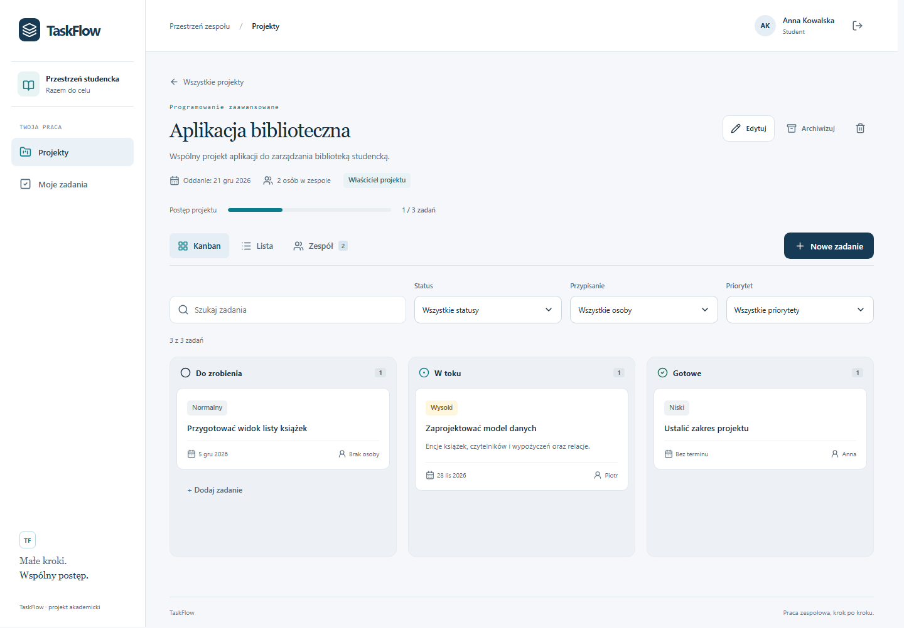

# TaskFlow


TaskFlow pomaga zespołom studenckim realizować projekty zaliczeniowe. Łączy projekty, terminy, Kanban, zadania i komentarze oraz kontrolę dostępu do zespołów. Projekt zaliczeniowy: Programowanie zaawansowane, WSB Merito, 2026/2027.

Autor: **Karol Scisłowski**. Projekt powstał ze znaczącym wsparciem Codex; zakres udziału AI opisuje [rejestr AI](docs/AI_REGISTER.md). Repozytorium jest publiczne na życzenie autora.

## Wymagania

- Docker Desktop z działającym silnikiem Linux/WSL2 oraz Docker Compose.
- Node.js 24 dla przygotowania lokalnej konfiguracji i pracy nad frontendem.
- SDK .NET 10.0.404 dla pracy nad backendem; sam start kontenerów nie wymaga lokalnego SDK.
- Dostęp do internetu przy pierwszym pobieraniu zależności i obrazów. Kalendarz ma tryb symulowany do demonstracji offline.

## Szybkie uruchomienie

```powershell
git clone https://github.com/Scisly/PZL-Scislowski-Karol.git
cd PZL-Scislowski-Karol
node scripts/setup.mjs
docker compose up --build --detach --wait
```

Otwórz **http://localhost:8080**. Swagger jest dostępny pod **http://localhost:8080/swagger** w konfiguracji demonstracyjnej.



Skrypt generuje losowe lokalne sekrety w ignorowanym `.env`; ponowne uruchomienie zachowuje istniejące wartości. Dane logowania pokaż wyłącznie w swoim terminalu:

```powershell
node scripts/setup.mjs --show-credentials
```

| Konto demonstracyjne | Przeznaczenie |
| --- | --- |
| owner@taskflow.local | Właściciel projektów, ustawienia i członkowie |
| member@taskflow.local | Wspólna edycja zadań i komentarze |
| outsider@taskflow.local | Pokaz izolacji od cudzych projektów |
| admin@taskflow.local | Lista kont, bez obejścia członkostwa projektów |

Można także zarejestrować nowe konto. Właściciel dodaje je do projektu po e-mailu. Dane demo są fikcyjne.

## Uruchomienie lokalne bez kontenera aplikacji

PostgreSQL pozostaje w Dockerze. Skrypt uruchamia osobny projekt Compose `taskflow-dev` z własną bazą dostępną lokalnie na porcie 55432, odczytuje lokalną konfigurację, wykonuje migracje i uruchamia API. Sekrety przekazuje przez środowisko procesu, bez drukowania ich w poleceniach. Standardowy Compose nie publikuje bazy; lokalny port dodaje wyłącznie `compose.dev.yaml`. Dane developmentu są oddzielone od pełnego środowiska `taskflow`.

```powershell
node scripts/dev-backend.mjs
```

W drugim terminalu:

```powershell
cd web
npm ci
npm run dev
```

Vite działa na http://localhost:5173 i przekazuje `/api` do backendu http://localhost:5080. Zainstalowany lokalnie SDK jest wykrywany przez `global.json`; na innym komputerze trzeba zainstalować wersję wskazaną w tym pliku.

## Model domenowy

`Project` obejmuje zadania i członkostwa. `TaskItem` ma status, priorytet, opcjonalny termin oraz przypisanie. `Comment` wiąże zadanie z autorem. `ProjectMember` realizuje relację użytkowników do projektów; `ApplicationUser` należy do Identity. Diagram i uzasadnienie: [model domenowy](docs/DOMAIN.md).

Termin zadania nie może przekroczyć terminu projektu. Archiwum blokuje zapis. Przypisanie wymaga członkostwa. Nie można usunąć właściciela ani członka z przypisanymi zadaniami. Właściciel zarządza projektem i zespołem; członkowie współdzielą CRUD zadań. Komentarz edytuje autor; właściciel może go usunąć.

## Baza danych

EF Core 10 i Npgsql korzystają z PostgreSQL 18. Migracja `InitialCreate` odtwarza schemat Identity i domeny, klucze oraz relacje. Compose uruchamia najpierw bazę, potem jednorazową usługę `migrate`, a następnie aplikację. Dane PostgreSQL są w nazwanym wolumenie i pozostają po `docker compose down`.

```powershell
dotnet ef migrations list --project src/TaskFlow.Api
dotnet ef database update --project src/TaskFlow.Api
dotnet ef migrations has-pending-model-changes --project src/TaskFlow.Api
```

Polecenia lokalne wymagają connection stringa do dostępnego serwera. Nie zapisuj go z prawdziwym hasłem w Git. `--migrate` stosuje migracje i jawnie włączony seed demonstracyjny, po czym kończy proces. Zwykły start API nie wykonuje migracji.

## Architektura i dependency injection

Domain jest niezależny od HTTP, EF i Identity. Api zawiera cienkie kontrolery, request/response DTO, usługi, dostęp do danych i integrację. Constructor injection i `Scoped` łączą usługi z zakresem `DbContext`. SRP: obsługa HTTP, reguły i klient zewnętrzny mają odrębne odpowiedzialności. DIP: kontrolery zależą od interfejsów usług, a doradca terminu od `IHolidayClient`.

Nie dodano ogólnego Repository, ponieważ powielałoby operacje EF Core bez dodatkowej wartości. Klient Nager jest **Adapterem** zewnętrznego DTO do własnego `PublicHoliday`. [Plan i decyzje](docs/PLAN.md), [audyt jakości](docs/QUALITY.md).

## API

Główne zasoby to `/api/projects`, `/api/tasks`, członkowie i komentarze. CRUD używa GET/POST/PUT/DELETE oraz statusów 200/201/204. Filtry zadań: `projectId`, `status`, `assignedUserId`. Dwa odczyty `/api/compare/tasks` pokazują Minimal API, współdzieląc te same usługi, DTO i autoryzację co kontrolery. Pełne requesty i odpowiedzi: [kontrakt API](docs/API.md).

Trzy przykłady LINQ: lista dostępnych projektów z agregacją postępu; zadania z filtrami i projekcją; komentarze uporządkowane po dacie. Odczyty używają `AsNoTracking`; operacje bazy są asynchroniczne. Encje EF nie są zwracane bezpośrednio do klienta.

## Uwierzytelnianie i autoryzacja

React używa sesji Identity w cookie HttpOnly. Mutacje przesyłają `X-CSRF-TOKEN`, pobierany z `/api/auth/csrf`; po rejestracji, logowaniu i wylogowaniu token jest odświeżany. Sesja nie jest zapisywana w localStorage.

Demonstracyjny `/api/auth/token` przyjmuje e-mail i hasło, zwraca JWT na 15 minut. W Swaggerze użyj przycisku **Authorize** i tokenu bez prefiksu Bearer. Nagłówek Bearer wybiera JWT bez fallback do cookie przy błędnym tokenie. Tokeny korzystają ze wspólnego `sub`, ról serwera i walidacji podpisu/issuer/audience/czasu.

Role: `Student` i `Admin`. Policy: `CanCreateProjects`. Członkostwo i własność są sprawdzane po stronie serwera także dla odczytów i Minimal API. Brak tożsamości daje 401, brak uprawnienia 403, niedostępny cudzy zasób 404. Konto z rejestracji nie może nadać sobie roli Admin.

## Obsługa błędów i logowanie

Globalny handler zwraca Problem Details z `errorCode` i `traceId`: 400 dla walidacji, 404 dla braku zasobu, 409 dla reguły biznesowej, 500 dla nieoczekiwanego błędu. Nie ujawnia stack trace. Integracja może dać 503/504. Nagłówek `X-Trace-Id` służy do korelacji odpowiedzi z logami.

Structured logging używa Information, Warning i Error. Logowanie nie zapisuje haseł, JWT, kluczy ani treści żądań uwierzytelniania. Przykładowe scenariusze i diagnostykę zawiera [scenariusz demonstracji](docs/DEMO.md).

## Integracja z usługą zewnętrzną

Typed HttpClient pobiera Nager v4, `Holidays/PL/{year}`. Oddzielne DTO jest mapowane na święta ogólnokrajowe typu Public. Timeout 5 s, CancellationToken, kontrolowane 404/429/500/503, nieprawidłowy JSON i timeout. Doradca sprawdza też weekend i przeszłość. Awaria kalendarza nie blokuje zapisu zadania, bo jest osobnym żądaniem.

W `.env`: `HOLIDAY_API_MODE=Stub` lub `Live`. Stub nie używa internetu; `HOLIDAY_API_STUB_SCENARIO` wybiera `Success`, `NotFound`, `RateLimited`, `Unavailable`, `Timeout`, `InvalidJson`. Po zmianie konfiguracji odtwórz usługi: `docker compose up --detach --force-recreate`. Integracja publicznego kalendarza nie wymaga klucza API.

## Testy i analiza jakości

```powershell
dotnet test TaskFlow.slnx --configuration Release
node scripts/verify.mjs --e2e
```

Testy jednostkowe xUnit izolują reguły i doradcę terminu przez fake klienta i kontrolowany czas. Integracyjne WebApplicationFactory uruchamiają osobny PostgreSQL 18 w Testcontainers i stosują migracje. Nie dotykają bazy użytkownika ani publicznego API. Przeglądarkowe Playwright obejmują konta, współpracę i uprawnienia.

Skrypt pełnej weryfikacji wykonuje restore/build/analyzers/testy, frontend, kontenery i E2E. Wyniki rzeczywistych uruchomień: [raport weryfikacji](docs/VERIFICATION.md). Repozytorium stosuje nullable, analizatory .NET i warnings-as-errors; frontend TypeScript i ESLint.

## Docker i CI/CD

Dockerfile ma etapy budowania Reacta, publikowania API oraz lekki ASP.NET Runtime. Jeden kontener serwuje UI i API. `.dockerignore` usuwa materiały, sekrety, wyniki i lokalne zależności z kontekstu. Aplikacja działa jako użytkownik bez uprawnień root.

```powershell
docker compose up --build --detach --wait
node scripts/smoke.mjs
docker compose logs app migrate
docker compose down
```

Port 8080 jest wystawiony na loopback. Konfiguracja i hasła pochodzą z `.env`, a nie Dockerfile. Pipeline GitHub Actions wykonuje restore, build, testy, analizę jakości, frontend, Docker build i sprawdzenie kontenera/przeglądarki. Błąd wymaganej kontroli blokuje sukces. Dowody kontrolowanego failed test→failed CI→naprawa znajdują się w raporcie weryfikacji.

## Ograniczenia i oddanie

Równoczesna edycja stosuje ostatni poprawny zapis. Wersja 1 nie ma realtime, paginacji, e-maili, resetu hasła, SSO, załączników ani publicznego wdrożenia. Swagger/JWT i konta demo są funkcjami jawnie włączonego środowiska demonstracyjnego. Dalsze ograniczenia: [known issues](docs/KNOWN_ISSUES.md).

[Scenariusz pokazu](docs/DEMO.md) · [Pytania do obrony](docs/DEFENSE.md) · [Materiały do Moodle](docs/SUBMISSION.md) · [Rejestr AI](docs/AI_REGISTER.md).

Materiały prowadzącego i oryginalne archiwa pozostają lokalnie w `materialy` i nie są częścią publicznego repozytorium. Oddanie w Moodle i przećwiczenie samodzielnego wyjaśnienia kodu wykonuje autor.
