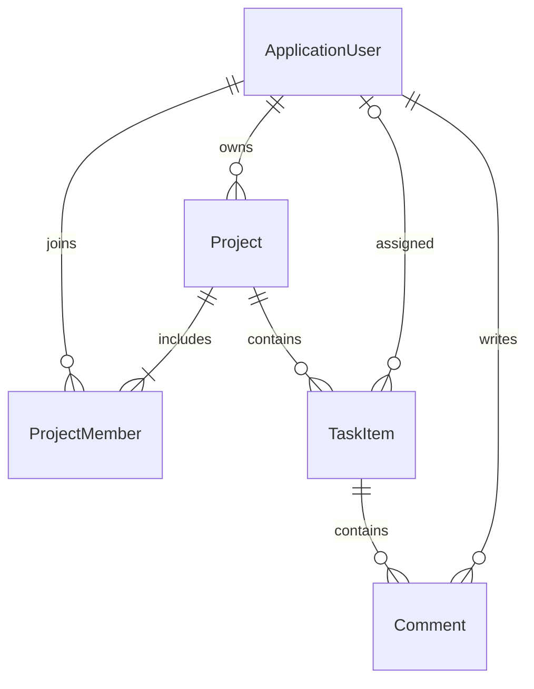

# Model domenowy

Projekt grupuje zadania i członków zespołu. Zadanie może mieć komentarze oraz opcjonalne przypisanie do członka projektu. Konto użytkownika jest obsługiwane przez ASP.NET Core Identity poza projektem Domain.

Właściciel jest zawsze członkiem projektu. `ProjectMember` ma unikalną parę identyfikatorów projektu i użytkownika. Domain przechowuje identyfikatory kont, a mapowanie kluczy obcych do `ApplicationUser` konfiguruje EF w projekcie Api.

Status zadania: `Todo`, `InProgress`, `Done`. Priorytet: `Low`, `Normal`, `High`. Opis, termin zadania i przypisanie są opcjonalne; termin projektu jest wymagany. Identyfikatory Guid nie są mechanizmem autoryzacji — członkostwo jest sprawdzane niezależnie dla każdego żądania.

Usunięcie projektu usuwa zależne członkostwa, zadania i komentarze. Usunięcie zadania usuwa jego komentarze. Archiwizacja zachowuje dane, ale blokuje ich modyfikację do czasu przywrócenia przez właściciela.
